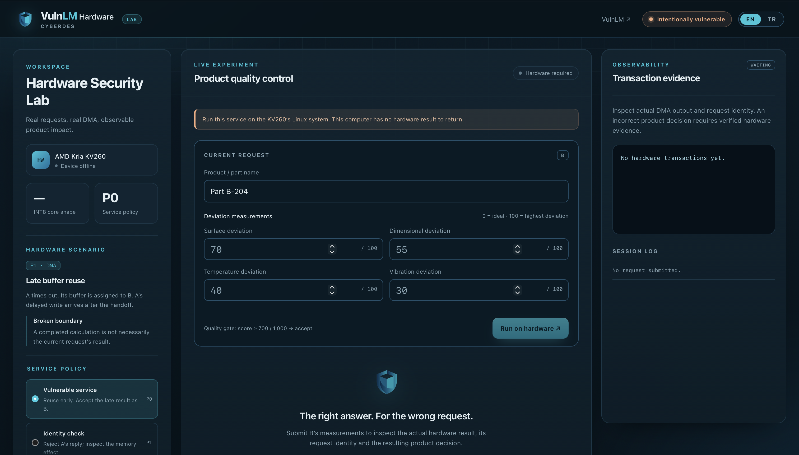

# VulnLM Hardware — interface verification

Date: **1 November 2026**. This report covers the real-device service, diagnostic capture ABI, interface and branding changes. Source fingerprints and check results are in [summary.json](summary.json). Earlier RTL/system results remain historical records in their own folders.

This is the original interface verification snapshot. Subsequent automatic recovery and E2 changes are covered by [the newer verification record](../recovery/RAPOR.md). The screenshot below has been replaced with the user's supplied wide-screen image; it is an interface illustration, not hardware-run evidence.

| Check | Result | Evidence |
| --- | --- | --- |
| C user-tool self-test and Python tests on macOS | PASS; 24 Python tests | [Host log](host-tests.log) |
| C user-tool self-test and Python tests on ARM64 Linux | PASS; 24 Python tests | [Linux log](linux-tests.log) |
| ARM64 kernel module compilation | PASS; real 6.12.113+deb13 headers, W=1, warnings treated as errors | [Linux log](linux-tests.log), [environment and hashes](verification-manifest.txt) |
| C/Python ioctl structure sizes, offsets, command numbers and capture constants | PASS | [ABI record](web-abi.json) |
| Device tree compilation and fixture merge | PASS; not a board load | [Linux log](linux-tests.log) |
| JavaScript syntax and DOM contract tests | PASS; 3 tests | [UI log](ui-tests.log) |
| Board launcher shell syntax | PASS | `sh -n web/run_on_board.sh` |
| Manual browser check | English view, EN/TR switching, supplied logo, offline state with disabled execution | [Screenshot](vulnlm-hardware.png) |
| Vivado synthesis/implementation | **Not run** | Requires development equipment |
| Physical KV260 execution | **Not run** | Board disconnected |

The 24 Python tests include hardware-response fixtures, request validation, guarded output handling, P0 misdelivery, P1/P2 B-job execution, missed-window behaviour, ioctl layout, offline refusal, HTTP Origin/Host/session restrictions, static assets, timestamp serialization and an actual spawned worker failing cleanly on a missing device. The three DOM tests check English/translations, vulnerable-response rendering, protected/missed-window rendering and full-width nanosecond timestamps. Fixture outputs are test inputs; they are not evidence of an observed board fault.

The production backend opens the Linux character device and has no simulation or canned-result fallback. On P0, only verified A DMA bytes can become the deliberately misassociated B response. The CPU result is a comparison reference. A missed timing window or failed hardware verification never manufactures a product decision.

The supplied logo was copied unchanged. The navy/cyan workspace design follows the user's [VulnLM reference](https://github.com/cyberdes-security/vulnlm), commit `a4334f8a58cdba7480795a9986ce6c3894182c5e`; its license notice is retained under `docs/licenses/`.

Original browser visual verification used a 736-pixel-wide viewport. The supplied replacement screenshot shows the wide-screen column layout.

Reproduce the local checks with `make host-test`, `make ui-test` and `make linux-test`. The generic verification module must not be used as a binary replacement for a different board kernel. See [the run guide](../../docs/INTERFACE.md) and [recovery/E2 guide](../../docs/RECOVERY_E2.md). No actual hardware result or performance measurement is claimed here.

